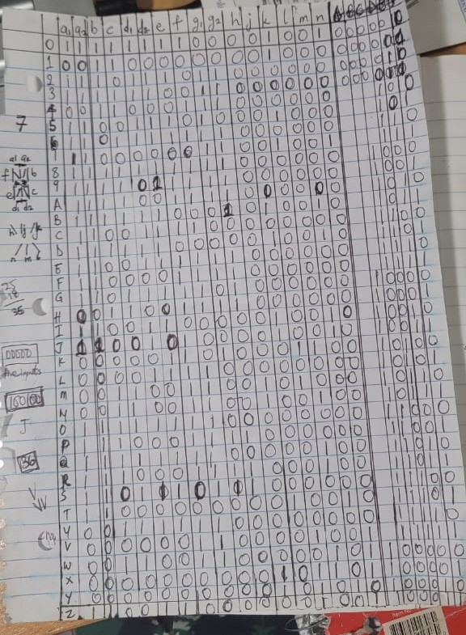

# Mod-36 Alphanumeric 16-Segment Display Controller (SystemVerilog)

A hardware-level Finite State Machine (FSM) and combinational logic decoder implemented in SystemVerilog. The design cycles through 36 distinct states (`0–9` and `A–Z`) using a 6-bit Mod-36 synchronous counter with wrap-around detection, driving a 16-segment starburst display (`a1` through `n`, excluding `i`).

## Live Interactive Visualizer
**[Launch the Interactive 16-Segment Simulator](https://Peter-004.github.io/mod36-fsm-verilog/)** 

## ⚙️ Architecture & Design Highlights
- **Mod-36 State Counter:** 6-bit synchronous counter (`000000` to `100011`) with active-low asynchronous reset (`rst_n`) and automatic rollover from state 35 (`Z`) back to state 0 (`0`).
- **Combinational Logic Minimization:** Truth table reduced via Quine-McCluskey / Espresso SOP minimization, leveraging states `36–63` as Don't Care (`X`) conditions to minimize gate count.
- **Segment Mapping:** 16 active-high outputs ordered `[a1, a2, b, c, d1, d2, e, f, g1, g2, h, j, k, l, m, n]`.
- **FPGA & Discrete Logic Ready:** Synthesizable RTL verified via self-checking testbench; directly portable to FPGA development boards (e.g., Sipeed Tang Nano 9K) with a clock divider or discrete IC implementations.

### Truth Table & State Mapping


## Verification & Simulation
The design is verified using a self-checking testbench compiled and executed via Icarus Verilog (`iverilog`):

```bash
iverilog -g2012 -o sim_fsm mod36_16seg.sv mod36_16seg_tb.sv
vvp sim_fsm
C:\Users\opemi\OneDrive\Documents\HDL_Projects\16_segment>vvp sim_fsm
-------------------------------------------------------------
Time(ns) | State (Bin) | Dec | Char | Segments [a1..n]      
-------------------------------------------------------------
16000      | 1     |  1  |  1   | 16'b11000000001000
26000      | 10     |  2  |  2   | 16'b1110111011000000
36000      | 11     |  3  |  3   | 16'b1111110011000000
46000      | 100     |  4  |  4   | 16'b11000111000000
56000      | 101     |  5  |  5   | 16'b1100111010001000
66000      | 110     |  6  |  6   | 16'b1101111111000000
76000      | 111     |  7  |  7   | 16'b1100000011001001
86000      | 1000     |  8  |  8   | 16'b1111111111000000
96000      | 1001     |  9  |  9   | 16'b1111010101000000
106000      | 1010     | 10  |  A   | 16'b1111001111000000
116000      | 1011     | 11  |  B   | 16'b1111110001000000
126000      | 1100     | 12  |  C   | 16'b1100111101000000
136000      | 1101     | 13  |  D   | 16'b1111110010010010
146000      | 1110     | 14  |  E   | 16'b1100111111000000
156000      | 1111     | 15  |  F   | 16'b1100001111000000
166000      | 10000     | 16  |  G   | 16'b1101111101000000
176000      | 10001     | 17  |  H   | 16'b11001101000000
186000      | 10010     | 18  |  I   | 16'b1100110000010000
196000      | 10011     | 19  |  J   | 16'b1100100000010000
206000      | 10100     | 20  |  K   | 16'b10001110000000
216000      | 10101     | 21  |  L   | 16'b111110000000
226000      | 10110     | 22  |  M   | 16'b11001100000000
236000      | 10111     | 23  |  N   | 16'b11001100000000
246000      | 11000     | 24  |  O   | 16'b1111111100001100
256000      | 11001     | 25  |  P   | 16'b1110001110000000
266000      | 11010     | 26  |  Q   | 16'b1111111100101110
276000      | 11011     | 27  |  R   | 16'b1110001110100110
286000      | 11100     | 28  |  S   | 16'b1111110111000000
296000      | 11101     | 29  |  T   | 16'b1100000000010010
306000      | 11110     | 30  |  U   | 16'b1111101000000
316000      | 11111     | 31  |  V   | 16'b1100001001
326000      | 100000     | 32  |  W   | 16'b11001100000101
336000      | 100001     | 33  |  X   | 16'b101101
346000      | 100010     | 34  |  Y   | 16'b101010
356000      | 100011     | 35  |  Z   | 16'b1100110000001001
366000      | 0     |  0  |  0   | 16'b1111111100001001
376000      | 1     |  1  |  1   | 16'b11000000001000
386000      | 10     |  2  |  2   | 16'b1110111011000000
396000      | 11     |  3  |  3   | 16'b1111110011000000
406000      | 100     |  4  |  4   | 16'b11000111000000
416000      | 101     |  5  |  5   | 16'b1100111010001000
426000      | 110     |  6  |  6   | 16'b1101111111000000
436000      | 111     |  7  |  7   | 16'b1100000011001001
446000      | 1000     |  8  |  8   | 16'b1111111111000000
456000      | 1001     |  9  |  9   | 16'b1111010101000000
-------------------------------------------------------------
Simulation completed successfully.
mod36_16seg_tb.sv:52: $finish called at 456000 (1ps)
